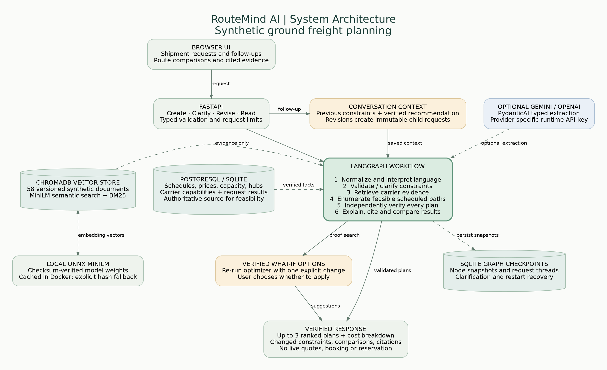

# RouteMind AI architecture



[Open the full-size PNG](architecture.png). The diagram uses a standard image so it does not depend on SVG or Mermaid preview support.

## Components

| Component | Responsibility | Implementation |
|---|---|---|
| Browser UI | Shipment entry, follow-ups, comparisons, citations and what-if actions | [Static frontend](../app/static/) |
| FastAPI | Typed HTTP contracts; new, clarify and revise endpoints | [main.py](../app/main.py), [schemas.py](../app/schemas.py) |
| Conversation context | Preserve unchanged constraints; create immutable child requests; resolve relative budget and arrival edits | [language.py](../app/language.py), [workflow.py](../app/workflow.py) |
| Language interpretation | Quantity/currency normalization and rules; optional typed PydanticAI extraction using prior context | [parser.py](../app/parser.py) |
| LangGraph | Conditional parsing, clarification, retrieval, search, verification and explanation | [workflow.py](../app/workflow.py) |
| ChromaDB and MiniLM | Persist and query learned vectors for versioned carrier evidence; combine results with an application-side BM25 index | [rag.py](../app/rag.py) |
| PostgreSQL / SQLite | Authoritative schedules, prices, capacities, carrier capabilities and visible request results | [database.py](../app/database.py), [seed.py](../app/seed.py) |
| Deterministic optimizer | Enumerate acyclic paths of up to three legs, rank feasible alternatives and independently verify their facts | [optimizer.py](../app/optimizer.py) |
| Verified what-if options | Re-run the optimizer under one proposed constraint change; never apply it without the user's choice | [suggestions.py](../app/suggestions.py) |
| SQLite checkpoints | Retain graph node snapshots and request threads across restarts | [Application lifespan](../app/main.py) |

## Important boundaries

- The optional Gemini or OpenAI model interprets language. It does not decide prices, capacity, schedules or carrier eligibility. The selected provider receives only its own configured key.
- Retrieved prose provides cited context. SQL capability flags and schedule records decide feasibility.
- Relative comparisons use saved, verified recommendations; the model does not invent reference costs or arrival times.
- Clarification resumes the same request. A revision creates a new request linked to its parent, preserving the earlier result.
- Docker runs PostgreSQL separately from the API. ChromaDB, local model weights and graph checkpoints are embedded in the application container; persistent volumes retain changing data. Native development can use SQLite instead of PostgreSQL.
- MiniLM weights are verified and cached during Docker build. Optional hosted language interpretation requires a provider-specific runtime API key. No live freight integrations or booking actions exist.

## Update the diagram

The editable source is [architecture.dot](architecture.dot). With Graphviz installed, regenerate the PNG from the repository root:

```bash
dot -Tpng -Gdpi=150 docs/architecture.dot -o docs/architecture.png
```

Graphviz is only needed to edit the diagram, not to run RouteMind.
