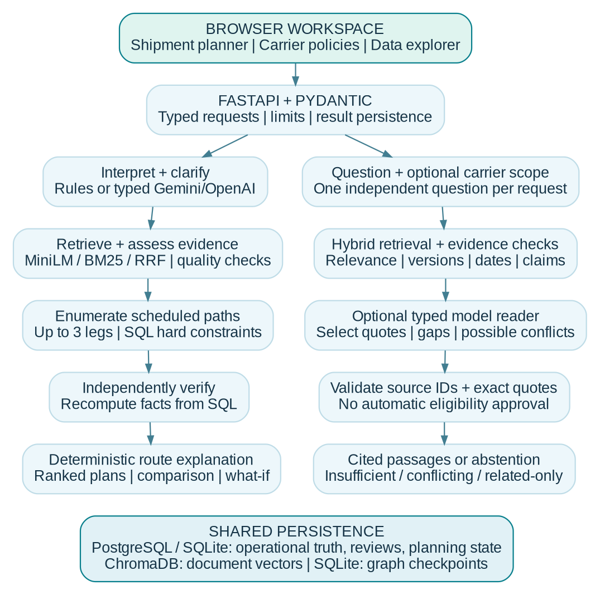

# RouteMind AI: Conversational Freight Planning with Verifiable Routes and Cited Evidence

**Project report — reformatted from the supplied technical document | November 14, 2026**

**Chetana Patel** — cpatel9@gmu.edu  
**Dilara Siraeva** — dsiraeva@gmu.edu  
**Minh N Phan** — mphan20@gmu.edu  

**Planning note:** Team contacts and checkpoint roles are confirmed. The final course deadline is pending; future assignments, resources and dates are proposed.

## 1. Project Description and Motivation

This report reorganizes the supplied technical document, RouteMind_AI_Technical_Document (1).pdf, into the course’s required structure. Its implemented architecture, algorithms, dataset counts, evidence safeguards and limitations are retained below. The attachment describes baseline 5d65e20; later evaluation tools are identified separately so an implemented runner is not confused with a completed live experiment.

RouteMind AI targets decision support for a single scheduled ground-freight shipment. A planner describes the origin, destination, pallet quantity, budget, delivery timing and cargo-handling needs in everyday language. The application asks for missing details, compares up to three feasible routes and explains cost, arrival and transfer trade-offs. Users can revise a request conversationally and ask carrier-policy questions with source citations.

The motivating problem is that a low price alone does not establish suitability: a service must also have sufficient capacity, practical connections and explicit handling eligibility. A shipment requirement may change during planning, requiring the options to be reconsidered without losing previously accepted constraints. Descriptive carrier information can be difficult to match to a customer’s wording and may omit important conditions. These are plausible workflow challenges motivating the prototype; the team has not yet measured real organizational time savings or financial impact.

For example, the supplied synthetic fixture moves 15 fragile pallets from Fremont to Austin under $4,000. One verified route through Phoenix costs $2,100; a direct service costs $3,400 and arrives eight hours earlier relative to the same scenario start. The application exposes the trade-off while leaving the final choice to the planner. The figures are illustrative rather than live quotes.

The design separates two kinds of evidence. SQL records and a deterministic optimizer establish operational facts such as price, capacity, timing and eligibility. Retrieval-augmented generation (RAG) supplies relevant document passages for policy questions and supporting explanations; it is not required to calculate routes and is not the only possible document-search method. The project’s contribution is an integrated, auditable application and comparative evaluation, not a new routing or embedding algorithm.

Research questions: (RQ1) Does hybrid semantic/keyword retrieval improve useful evidence retrieval over BM25 alone on independently phrased policy questions? (RQ2) Does typed LLM extraction improve requirement interpretation and clarification compared with rules on the same requests? (RQ3) How well do evidence checks, cited passages and abstention support policy-answer quality without changing SQL route eligibility? A negative or mixed result is a valid outcome.

Scope is road freight by truck, one shipment and at most three scheduled legs. Live rates, dispatch, booking, capacity reservations, air/rail/ocean transport and fleet-wide optimization are excluded. The current prototype uses a fixed November 1–7, 2026 schedule, not a rolling live transport network.

## 2. Related Work

Lewis et al. (2020), Retrieval-Augmented Generation for Knowledge-Intensive NLP Tasks [1]. The paper combines a pretrained sequence-to-sequence model with a dense index of external passages for knowledge-intensive NLP tasks. Retrieved passages condition the generated output, connecting parametric model knowledge with non-parametric memory. RouteMind reuses pretrained models and a small hybrid document index rather than training the paper’s jointly optimized RAG architecture. It also separates document interpretation from deterministic route verification, so generated text cannot establish operational eligibility or invent route prices.

Reimers and Gurevych (2019), Sentence-BERT: Sentence Embeddings using Siamese BERT-Networks [2]. The authors develop sentence representations using siamese/triplet network structures so that semantic similarity can be computed efficiently with cosine similarity. They evaluate the representations on semantic textual similarity and transfer tasks. RouteMind uses an off-the-shelf MiniLM sentence-embedding model for local retrieval rather than training a new Sentence-BERT model or claiming to reproduce its benchmark results. Our evaluation instead examines whether semantic similarity, combined with BM25, retrieves useful freight-policy evidence and where exact keyword matching remains stronger.

Es, James, Espinosa Anke and Schockaert (2024), RAGAs: Automated Evaluation of Retrieval Augmented Generation [3]. RAGAs introduces reference-free evaluation of retrieval-augmented systems across retrieved context and generated-answer quality. It uses automated metrics to support evaluation when exhaustive human reference answers are unavailable. RouteMind has an optional Ragas adapter for faithfulness, context precision without reference and a binary relevance critic, complemented by deterministic route checks and a proposed human review. Unlike an automated-only quality claim, we will disclose judge bias, missing scores and the fact that verbatim quotation can make faithfulness high even when an answer is incomplete or irrelevant.

## 3. Project Plan

### 3.1 Dataset(s)

| Dataset | Access / status | Use |
| --- | --- | --- |
| Synthetic transportation network: 18 hubs, 10 fictional carriers, 180 scheduled services, 40 capability flags | Available in app/seed.py; fixed random seed and handcrafted fixtures | Check capacity, schedules, transfer rules, costs, capabilities and reliability thresholds. |
| 58 short passages: 50 carrier sections, 4 handling notes, 4 generic planning cases | Available in the repository; authored synthetic text | Document retrieval, policy Q&A and evidence-quality tests. Five carrier sections are near-duplicates. |
| 100 planning regressions; 60 retrieval queries; 16 earlier NLP paraphrases | Available as JSON in evaluations/ | Known-result checks and comparisons of dense, BM25, hybrid and token-coverage ranking. |
| Quality suite: 64 NLP cases and 50 policy questions | Available in evaluations/quality/cases.json; 32/32 NLP and 25/25 policy development/test splits | Micro entity metrics, clarification checks, policy retrieval and evidence-gate proxies. |
| Additional independently written requests and policy questions | Planned, not collected: 30 NLP requests (10 per member) and 18 policy questions (6 per member) | Reduce dependence on existing shared templates; include negation, missing facts, conflicting requirements and paraphrases. |

Existing operational data is generated or authored by the project, not obtained from a real carrier or customer. Familiar US location names do not make the services real. Access to the existing synthetic corpus and labels is confirmed; access to private contracts, real shipment records or licensed carrier APIs is neither required nor assumed. The pretrained all-MiniLM-L6-v2 model is a public model artifact [4], not a freight dataset or a model trained by the team.

For the additional set, each member will author examples independently, and another member will verify labels before model evaluation. A provisional split is 20/10 development/test NLP cases and 12/6 policy cases, grouped by scenario or document family rather than random paraphrase. The exact manifest will be frozen before testing; test cases will not be used for threshold tuning. Any new corpus passages will remain clearly fictional and reviewed, with versions and dates where available; public carrier documents would require separate provenance and usage checks.

Current labels are synthetic, templates overlap and test labels are visible in the repository. These limitations prevent claims of general operational accuracy. Planning cases are generic notes, not detailed historical shipments. Customer-email ingestion and live external data remain deferred.

### 3.2 Implementation

#### 3.2.1 Architecture and workflow

The implemented planning flow is browser → FastAPI → LangGraph parse → validate/clarify → retrieve → optimize → verify → explain → persist and return. The interface includes Shipment planner, Carrier policies and the read-only Data explorer. The following architecture figure is reproduced from the uploaded technical document rather than implying a new graph feature.

| Software / component | Implemented responsibility | Future work / boundary |
| --- | --- | --- |
| Python 3.12; FastAPI; Pydantic | Typed request validation, API endpoints and static frontend | No production user login or tenant authorization. |
| PydanticAI; optional Gemini/OpenAI | Typed requirement extraction and policy-passage selection | Hosted answer quality remains unmeasured in saved offline results. |
| LangGraph; SQLite checkpoints | Stateful parsing, validation, retrieval, search, verification and explanation | Clarifications reinvoke saved state; no automatic mid-node crash replay. |
| SQLAlchemy; PostgreSQL / SQLite | Authoritative schedules, prices, capacities, capabilities and saved request state | Combined schedules and JSON plans simplify the MVP schema. |
| MiniLM / ONNX; ChromaDB; BM25; RRF | Local embeddings, semantic/keyword retrieval and rank fusion | Token-coverage reranker exists; a cross-encoder does not. |
| pytest; browser scripts; Docker Compose; CI | Correctness checks, reproducible operation and workflow testing | These do not establish operational reliability or real carrier suitability. |

The rules parser normalizes quantities, currency, hub aliases and supported cargo terms. Optional model fields default to null so omitted values do not erase accepted requirements; structured controls override extraction. Clarification preserves the request/thread and accepted fields. A revision creates a child request with its own ID, links to its parent and compares against a verified baseline, keeping earlier results unchanged.

#### 3.2.2 Deterministic routing and verification

The optimizer recursively enumerates acyclic scheduled paths with at most three legs. Each expansion checks continuity/cycles, pallet capacity, required SQL capability flags, minimum per-carrier reliability, ready/connection times, deadline, stops and accumulated cost. Costs use integer USD cents; timestamps require timezones and are normalized to UTC. The supported capability flags are fragile, secure, refrigerated and hazmat; pharmaceutical certification and numeric temperature ranges are not modeled.

Cheapest ranks by cost then arrival; fastest ranks by arrival then cost, with documented handling/direct-route preference rules and stable schedule-ID tie breaks. No dominance pruning is used because it can discard requested alternatives. verify_plan independently reloads schedules and recomputes the entire result against SQL. Rejection counts are rejected search transitions, not separate routes or a minimal infeasibility proof; carrier on-time rates are never multiplied into an invented route probability.

Verified what-if options change one supported constraint and re-run search/verification. The user chooses whether to apply a suggestion; capacity, capability and reliability requirements are not silently relaxed. Routes are simulated trucking services between hubs, not exact highway navigation or freight bookings.

#### 3.2.3 Hybrid RAG and carrier-policy safeguards

Short authored passages are embedded with checksum-verified ONNX all-MiniLM-L6-v2 into 384-dimensional vectors stored in ChromaDB. Dense cosine-similarity ranking and application-side BM25 are merged with reciprocal rank fusion, score(d) = sum[1 / (60 + rank(d))]. The app can compare dense, BM25, hybrid and token-coverage reranking, but does not claim the latter is a learned cross-encoder. In auto mode, an explicitly reported hash-vector fallback supports offline operation; strict MiniLM mode fails if the learned model cannot load.

Evidence assessment requires meaningful content-term overlap or learned cosine similarity of at least 0.55. This is an uncalibrated relevance heuristic, not confidence or proof of completeness. Optional document_reviews metadata groups revisions of one passage, excludes future/expired sources and checks reviewed capability claims against SQL. Undated sources retain unknown freshness. General prose conflicts can be flagged by the configured model with exact source quotations; they require review and are not automatically resolved.

Policy questions can scope up to two carriers. A typed reader selects quotations and unanswered parts, and the API validates source IDs and exact text before displaying full paragraphs. States distinguish answered, not_documented, related_documents, insufficient_evidence and conflicting_evidence. Missing/conflicting/unverifiable evidence prevents an approved policy answer; it does not become an eligibility approval or a negative carrier policy. Planning can continue with verified SQL records while suppressing unsupported prose claims.

The current corpus is already short; there is no general PDF upload/chunking pipeline. Text changes require a restart to refresh loaded documents and embeddings; review metadata is read at assessment time. Collections are separated by embedding version. These scope limits from the attachment are preserved.

#### 3.2.4 Persistence, interfaces and operation

SQL tables cover hubs, carriers, carrier_capabilities, combined schedules/rates, shipment_requests, documents and document_reviews. Plans and leg details are stored within JSON request snapshots rather than separate normalized plan tables. The explorer allows bounded literal search/pagination of reference tables and actual stored vectors; it excludes shipment conversations and arbitrary SQL. Policy questions are independent and are not saved in shipment history. No authenticated user-level audit trail is implemented.

| Interface | Purpose | State / limit |
| --- | --- | --- |
| POST /api/v1/plans; /{id}/clarify; /{id}/revise | Create, clarify or revise shipment planning requests | completed, needs_clarification, no_route or error. |
| GET /api/v1/plans/{id}; /{id}/alternatives | Read persisted results and up to three ranked options | Read access is not protected by tenant authorization. |
| POST /api/v1/policies/questions | Read carrier documents with optional two-carrier scope | Exact citations and explicit abstention/review states. |
| GET /api/v1/explorer and its table/vector routes | Read-only reference data and the active Chroma collection | Allowlist; bounded paging; no document-editing API. |
| GET /api/v1/hubs; /health; browser /docs | Hub choices, readiness and interactive API documentation | Demo readiness is not production service certification. |

Docker Compose runs PostgreSQL and a non-root API with retained SQL/evidence/checkpoint data. Native development can use SQLite; one API worker is supported. Environment variables choose the provider/model, provider-specific key, database, data directory and embedding backend. Native startup does not automatically load .env. Credentials stay outside source control. Existing protections include 16 KiB POST limits, 30 POSTs/minute/IP in-process limits, CORS allowlists, parameterized SQL and redacted HTTP errors; production authentication, migrations, least-privilege DB roles, distributed coordination and retention management remain future work.

#### 3.2.5 Remaining implementation and design choices

The original technical document’s deterministic route explanations, custom responsive frontend, bounded exhaustive search and simplified schema remain intentional choices. They replace the proposal’s LLM numerical explanations, Streamlit UI, dominance-pruned search and more normalized schema without removing the core user flow. An optional Ragas adapter, paired parser comparison and independent reviewer pack were subsequently added after baseline 5d65e20; this updates the attachment’s older “Ragas not implemented” statement, but does not imply that live Ragas scores now exist.

The remaining required work is to add independently written examples, run controlled model/judge comparisons, extend the reviewer assignment for three team members, collect human ratings and analyze failure cases. Cross-encoder deployment, public real-time feeds, customer-email ingestion, fleet/multimodal optimization and production hardening are deferred. No model training or autonomous carrier mutation is proposed for this final scope.

### 3.3 Resources

| Resource | Requirement / estimate | Availability |
| --- | --- | --- |
| CPU and memory | Planning estimate: a 4-logical-core machine with 8 GB RAM; serialize model/judge calls | Existing cloud workspace and prior CPU-only application/test execution are verified; future exclusive quotas and each member’s hardware are not confirmed. |
| Storage | Plan for about 10 GB free for environments, container images, cached weights and reports | Repository and sample data are accessible; this is a planning allowance, not measured peak consumption. |
| GPU / ORC Hopper | No GPU needed for the baseline: small local embeddings and deterministic routing; no training | Hopper access/allocation has not been confirmed and is not assumed. It is optional only if a later experiment requires acceleration. |
| Hosted LLM / judge | Provider-specific API access; start with 10 paired parsing cases and at most 10 answered outputs for judging | Local keys, account quotas and a spending ceiling require team confirmation. No live credential is configured in the inspected cloud environment. |
| Human review | Proposed 10 outcomes per member; one calibration discussion and independent scoring | All three members are proposed reviewers; participation and scheduling require confirmation. |

A provisional API allowance of USD 10–20 is proposed for a small pilot, subject to team approval and current provider pricing; it is not an approved budget or guaranteed cost estimate. The existing policy runner also performs extraction, and Ragas may issue several judge calls per answer/context, so “10 answers” does not mean only 10 API calls. We will record actual requests/tokens where available, keep concurrency/retries/output limits bounded and check spend before expanding the run. Command-line limits are not a monetary spending cap.

Resources will be obtained from team-owned machines and the existing managed workspace first, with provider accounts for the explicitly enabled hosted experiments. If credentials, budget or quotas cannot be secured, we will deliver the offline comparison and mark live columns unmeasured rather than inventing results.

### 3.4 Evaluation

| Dimension | Dataset / comparison | Metrics and checks |
| --- | --- | --- |
| Requirement interpretation | Same development/test requests for rules and typed LLM extraction; add independently phrased cases | Micro field/value precision, recall and F1; per-field results; exact-field accuracy; clarification accuracy; model failures. |
| Retrieval | Existing 60-query labels plus new policy questions; dense, BM25, hybrid and token-coverage ablations | Recall@5, MRR, nDCG@5; report gold-set size and near-duplicate limitations. |
| Feasibility and optimality | Handcrafted fixtures, independent exhaustive oracle on small random networks, adversarial constraints | Feasible-route accuracy, optimal-route agreement, cost/time recomputation and constraint-violation counts. |
| Policy answers and abstention | Saved live policy responses, answerable/unanswerable labels, missing/stale/conflicting sources | Gold-source citation precision; exact-quote validity; inappropriate answers/abstentions; judged relevance and failed-call counts. |
| Ragas judge | Up to 10 eligible live answered outputs; explicit provider/model and input hash | Faithfulness, context precision without reference, binary answer relevance via AspectCritic; nulls and per-metric denominators retained. |
| Human review | Proposed 3 members × 10 outcomes; 6 shared + 4 unique per person = 18 unique outcomes | 1–5 relevance/grounding/completeness/clarity; decision appropriateness; unsupported statements; pairwise raw agreement and weighted kappa on overlap. |
| Usability / performance | Representative browser workflows and serial end-to-end samples | Task completion, errors, observed latency P50/P95 and qualitative case studies; not claimed productivity or savings. |

Quantitative safeguards. Both parsers receive identical inputs and labels; a failed LLM call is not hidden by a rules fallback or credited as a correct clarification. Retrieval, parsing and route correctness are measured separately. Judges score the actual displayed passages, not an invented answer; abstentions/retrieval-only responses are excluded from answer faithfulness instead of receiving perfect scores. Failed/NaN judge outputs remain null, and report/model/dataset identifiers make the run auditable.

Qualitative protocol. Before formal rating, reviewers will discuss a small calibration example excluded from the scored pack, then rate independently without seeing gold labels, aggregate scores or one another’s ratings. No-answer outcomes use N/A for answer-only grounding/completeness fields while decision appropriateness is still rated. Reviewers see retrieved context, so a completeness rating cannot prove that the entire knowledge base contains no omitted policy. Disagreements will be discussed after independent submissions and summarized as case studies.

The existing pack generator supports two reviewers with 10 cases each and five shared cases. Extending assignment and agreement aggregation to the proposed three-member, six-shared-case design is planned work, not an already delivered feature. Thirty ratings over 18 unique outcomes form an exploratory review, not 30 independent examples or a population hallucination estimate. Weighted kappa will be reported only when defined; constant matching ratings may yield perfect raw agreement but undefined kappa.

Evidence available at this checkpoint. Saved offline quality reports show rules entity F1 and clarification accuracy of 1.00 on 32 test requests, policy response-evidence recall of 0.90, and a test relevance-gate proxy of 0.96 for MiniLM. The MiniLM development gate proxy is 0.88, demonstrating false admissions remain possible. These are synthetic/template results; response-evidence recall is not Recall@5, and the gate proxy is not answer correctness. Automated route tests, browser checks and Ragas API compatibility checks with fake chat exist, but actual live-model/Ragas scores and completed human ratings remain unmeasured. No new experiment is claimed by preparation of this report.

#### 3.4.1 Recorded baseline results and reproducibility

| Saved quality run | Rules F1 / clarification | Policy recall / gate proxy |
| --- | --- | --- |
| Development / Hash | 1.00 / 1.00 | 0.90 / 0.96 |
| Development / MiniLM | 1.00 / 1.00 | 0.90 / 0.88 |
| Test / Hash | 1.00 / 1.00 | 0.90 / 0.96 |
| Test / MiniLM | 1.00 / 1.00 | 0.90 / 0.96 |

The uploaded document records 107 tests passing on each of SQLite and PostgreSQL at its historical baseline. Its earlier MiniLM retrieval Recall@5 values are dense 0.9500, BM25 0.9667, hybrid 0.9633 and token-coverage reranking 0.9467 on 60 synthetic queries. These figures are retained as dated regression evidence, not newly rerun experiments or proof that hybrid search is always best. Verbatim quotation can make faithfulness high without answering a question completely.

Reproduction uses pytest, evaluations.run and evaluations.quality.run; paired parsing, optional judging and rating aggregation are documented in evaluations/quality/REVIEW_GUIDE.md. Offline mode never calls hosted models, even when credentials are configured. Live generation and judging require explicit flags and local keys; reports retain dataset/model provenance and missing-score counts. No live Gemini/OpenAI or Ragas score, completed human review, isolated production latency or actual savings is asserted by this report.

Final analysis will report denominators, failures, paired disagreements and representative successes/failures. We will not claim that RAG is the only solution, that a language model must beat rules, that verbatim citations guarantee completeness, or that the prototype has produced real financial savings.

## 4. Team Work and Timeline Clarification

### 4.1 Contribution to This Checkpoint and Final Collaboration

Verified team-level checkpoint outputs include the working shipment planner, synthetic datasets, hybrid retrieval, source-backed policy flow, SQL verification, conversational revisions, data explorer, evidence safeguards, evaluation runners and presentation materials. These deliverables are visible in the repository. The team has confirmed the checkpoint responsibilities below: Chetana led implementation, Dilara led evaluation, and Minh led data. These are member-reported contributions; the report does not infer task-level effort or ownership from Git author names.

| Member | Actual contribution to this checkpoint | Proposed final-project responsibility |
| --- | --- | --- |
| Chetana Patel | Implementation (confirmed by the team) | Application/conversation integration and paired parsing evaluation; contribute data labels, human review, report writing and peer review. |
| Dilara Siraeva | Evaluation (confirmed by the team) | Retrieval/evidence experiments and Ragas analysis; contribute data labels, human review, report writing and peer review. |
| Minh N Phan | Data (confirmed by the team) | Data curation, provenance and label validation; contribute routing gold-case verification, human review, report writing and peer review. |

Workload proposal: each member contributes approximately five hours per week for four weeks (about 20 hours each; 60 team hours total), subject to availability. Each person will author 10 new NLP requests and six policy questions, review 10 policy outcomes, implement or validate a technical component, write their methods/results section and peer-review another section. Responsibilities rotate for integration, so one person is not left with all implementation or final writing. Actual effort and deliverable ownership should be recorded in a shared task log and reviewed weekly. These are proposed allocations, not confirmed commitments or completed contributions.

### 4.2 Concrete Provisional Timeline

The final course deadline has not been provided. The following concrete four-week schedule starts Monday, November 16, 2026 and must be adjusted to the instructor’s actual deadline. Dates below are proposed milestones, not an assertion that the submission is due December 13.

| Dates | Milestone / exit evidence | Shared responsibility |
| --- | --- | --- |
| Nov 16–22, 2026 | Confirm deadline, availability and budget; independently author/verify labels; freeze development/test manifest and baseline settings | All: about 5 hours each. Chetana coordinates parser cases; Dilara policy cases; Minh dataset provenance, split checks and routing gold cases. |
| Nov 23–29, 2026 | Run paired parsing and retrieval ablations; execute capped live policy/Ragas pilot if access is confirmed; save model/version/failure records | All: about 5 hours each. Each lead owns a technical evaluation and another member checks its output. |
| Nov 30–Dec 6, 2026 | Extend reviewer assignments to three people; calibrate, independently rate 10 outcomes each, compute agreement and analyze failure cases | All: about 5 hours each. Keep calibration separate and do not tune on final test cases. |
| Dec 7–13, 2026 | Freeze code; perform final test-split run, reproduce results, complete limitations and report; rehearse integrated demonstration | All: about 5 hours each. Each writes a section and reviews another; team jointly approves final claims. |

If time or provider access is limited, preserve routing correctness, honest result reporting and independent review of available outcomes. Reduce the number of optional judge/ablation runs rather than manufacturing missing scores. Public live-data integration, cross-encoder deployment and fleet/multimodal extensions are deferred beyond the required scope.

## 5. References

[1] Lewis, P., et al. (2020). Retrieval-Augmented Generation for Knowledge-Intensive NLP Tasks. Advances in Neural Information Processing Systems, 33, 9459–9474. https://arxiv.org/abs/2005.11401

[2] Reimers, N., and Gurevych, I. (2019). Sentence-BERT: Sentence Embeddings using Siamese BERT-Networks. Proceedings of EMNLP-IJCNLP, 3982–3992. https://doi.org/10.18653/v1/D19-1410

[3] Es, S., James, J., Espinosa Anke, L., and Schockaert, S. (2024). RAGAs: Automated Evaluation of Retrieval Augmented Generation. Proceedings of EACL: System Demonstrations, 150–158. https://doi.org/10.18653/v1/2024.eacl-demo.16

[4] Sentence Transformers. all-MiniLM-L6-v2 model card (pretrained model resource, not counted among the three research papers). https://huggingface.co/sentence-transformers/all-MiniLM-L6-v2

[5] Project repository and reproducibility evidence: https://github.com/chetsp/RouteMind-AI ; implementation reviewed at commit 86f5b1c. Relevant files: app/seed.py, app/optimizer.py, app/rag.py, app/evidence.py, evaluations/REPORT.md, evaluations/quality/README.md and evaluations/quality/REVIEW_GUIDE.md. Scholarly descriptions were checked against the official ACL Anthology metadata and author/maintainer repositories where accessible; reported project metrics come from saved repository results.

[6] Supplied source document: RouteMind_AI_Technical_Document (1).pdf, technical implementation, changes and future enhancements, baseline 5d65e20 (November 2, 2026). Source of the retained architecture, implemented scope and historical benchmark descriptions.
